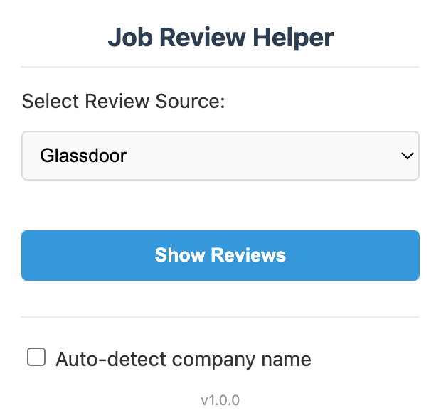

# Job Review Helper

A Chrome extension that opens Glassdoor or Indeed reviews for the company on the job posting you're viewing.

I built it while applying for jobs, after one too many rounds of copying a company name into another tab. Click the icon, pick a review site, and the reviews open in a small window you can drag and resize. It works on Handshake, LinkedIn, Indeed and most job boards; highlight a name to search for that instead.

## Install

1. Clone or download this repository.
2. In Chrome, open `chrome://extensions/` and turn on Developer mode.
3. Click "Load unpacked" and pick this folder.

## Why it's built this way

- **It searches instead of guessing the review page's URL.** Company slugs on both sites are inconsistent ("Acme Corp" vs "acme-corporation"), and their own search handles that better.
- **Selectors run most specific first.** Each site gets its own list (Handshake company links and employer pages, LinkedIn's top card, Indeed's company field), then generic ones like `.company-name`. The first that returns a name wins.
- **If it can't find a name, it asks** rather than searching for something wrong.
- **Only the company name leaves your browser**, sent to the review site you picked. Permissions are limited to reading the current tab, remembering your choice and opening the window. See [PRIVACY.md](PRIVACY.md).

## Limits

- Handshake's last fallback uses a generated class name that will break when they rebuild the site; the earlier checks usually still catch it.
- Chrome only.

After editing, hit reload on the extension's card in `chrome://extensions/`. MIT license.
